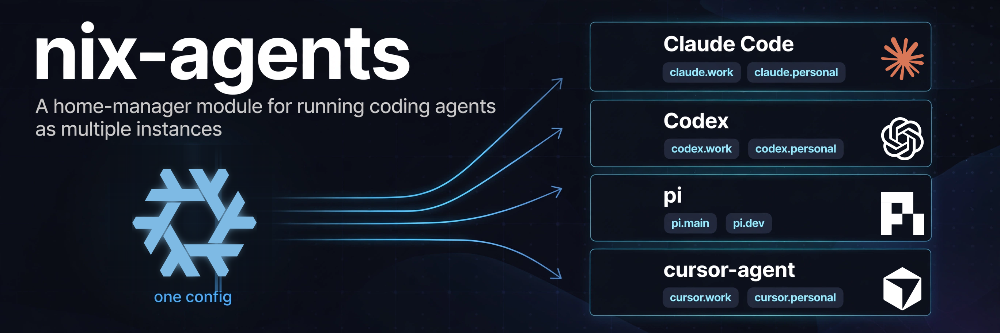

<p align="center">
  
</p>

<p align="center"><strong>A home-manager module for running coding agents as multiple instances</strong></p>

<p align="center">
  <a href="https://github.com/conao3/nix-agents/actions/workflows/ci.yml"></a>
  <a href="LICENSE"></a>
  <a href="https://github.com/conao3/nix-agents/stargazers"></a>
</p>

<p align="center">
  <a href="#what-it-solves">What it solves</a> ·
  <a href="#supported-agents">Supported agents</a> ·
  <a href="#installation">Installation</a> ·
  <a href="#minimal-example">Minimal example</a> ·
  <a href="#how-it-works">How it works</a> ·
  <a href="#options">Options</a>
</p>

# nix-agents

`nix-agents` is a [home-manager](https://github.com/nix-community/home-manager) module, `programs.agents`, that runs command-line coding agents (Claude Code, Codex, pi, cursor-agent) as several independent **instances** on 1 machine. You declare the instances, the MCP servers and the settings in Nix, and each instance gets its own executable and configuration directory:

```console
$ claude.personal   # runs claude with CLAUDE_CONFIG_DIR=~/.agents/.claude.personal
$ claude.work       # runs claude with CLAUDE_CONFIG_DIR=~/.agents/.claude.work
$ codex.personal    # runs codex with CODEX_HOME=~/.agents/.codex.personal
```

## What it solves

- **Several instances of one agent.** Each instance is an executable such as `claude.work` that runs the agent with its own configuration directory (`CLAUDE_CONFIG_DIR=~/.agents/.claude.work`). Accounts, credentials and state stay apart, and instances of the same agent can still share 1 directory for projects, history and settings.
- **One MCP server list for all your agents.** You declare MCP servers once in `programs.agents.mcpServers`, and the module renders them into each agent's own format: Claude Code's `settings.json` and `.claude.json`, Codex's `config.toml`, cursor-agent's `mcp.json`.
- **Secrets outside the Nix store.** You give a server's credential as an environment variable name (`bearerTokenEnvVar`) or a file path (`bearerTokenFile`). For Claude Code, a generated `headersHelper` command reads the file at connection time. The store holds the name or the path and nothing more.
- **Agents that rewrite their own configuration.** Agents write to the same files you want to manage (`settings.json`, `.claude.json`, `config.toml`). A read-only store symlink breaks them, and a fresh copy on each switch discards what they wrote. Each managed file picks a `strategy`: `merge` applies the keys you declare to the existing file on activation and leaves the rest, `overwrite` replaces the file with a fresh copy, and `link` keeps the usual read-only symlink.

The upstream home-manager modules `programs.claude-code`, `programs.codex` and `programs.mcp` manage 1 configuration directory per agent through store symlinks. Reach for `nix-agents` when you need several instances, shared directories, or files that the agent edits.

## Supported agents

| Agent | nixpkgs package | `envVar` | `homeDir` | `instructionsFile` | MCP `format` and file |
|---|---|---|---|---|---|
| Claude Code | `claude-code` (unfree) | `CLAUDE_CONFIG_DIR` | `.claude` | `CLAUDE.md` | `claude`: `settings.json`, `.claude.json` (key `mcpServers`) |
| Codex | `codex` | `CODEX_HOME` | `.codex` | `AGENTS.md` | `codex`: `config.toml` (key `mcp_servers`) |
| pi | `pi-coding-agent` | `PI_CODING_AGENT_DIR` | | `AGENTS.md` | |
| cursor-agent | `cursor-cli` (unfree) | `CURSOR_HOME` | | `AGENTS.md` | `cursor`: `mcp.json` (key `mcpServers`) |

The module doesn't hard-code these agents. Each one is an entry in `programs.agents.types` with an executable and the variable that selects its configuration directory, and the table lists the values the examples below use. You can add any agent that reads its configuration directory from an environment variable the same way; MCP rendering covers the 3 formats above.

This configuration declares all 4:

```nix
{ pkgs, ... }:
{
  programs.agents = {
    enable = true;

    types = {
      claude = {
        package = pkgs.claude-code;
        envVar = "CLAUDE_CONFIG_DIR";
        homeDir = ".claude";
        instructionsFile = "CLAUDE.md";
      };
      codex = {
        package = pkgs.codex;
        envVar = "CODEX_HOME";
        homeDir = ".codex";
      };
      pi = {
        package = pkgs.pi-coding-agent;
        envVar = "PI_CODING_AGENT_DIR";
      };
      cursor-agent = {
        package = pkgs.cursor-cli;
        envVar = "CURSOR_HOME";
        mcp = {
          format = "cursor";
          key = "mcpServers";
          files = [ "mcp.json" ];
        };
        files."mcp.json" = {
          scope = "instances";
          strategy = "overwrite";
        };
      };
    };

    instances = {
      "claude.personal" = { };
      "codex.personal" = { };
      "pi.personal" = { };
      "cursor-agent.personal" = { };
    };
  };
}
```

## Requirements

- Nix with flakes enabled.
- home-manager used from a flake, either standalone (`home-manager.lib.homeManagerConfiguration`) or as a NixOS / nix-darwin module.
- The flake is checked on `x86_64-linux`; it also declares `aarch64-darwin`. `mcpServers.<name>.service` creates systemd user services and takes effect on Linux only.
- `claude-code` and `cursor-cli` are unfree in nixpkgs. Set `config.allowUnfree = true` (or `allowUnfreePredicate`) on the `pkgs` you pass to home-manager.

## Installation

Add the flake input and import `homeManagerModules.default` into your home-manager configuration. A complete standalone flake:

```nix
{
  inputs = {
    nixpkgs.url = "github:nixos/nixpkgs/nixpkgs-unstable";
    home-manager = {
      url = "github:nix-community/home-manager";
      inputs.nixpkgs.follows = "nixpkgs";
    };
    nix-agents = {
      url = "github:conao3/nix-agents";
      inputs.nixpkgs.follows = "nixpkgs";
      inputs.home-manager.follows = "home-manager";
    };
  };

  outputs =
    { nixpkgs, home-manager, nix-agents, ... }:
    {
      homeConfigurations.alice = home-manager.lib.homeManagerConfiguration {
        pkgs = import nixpkgs {
          system = "x86_64-linux";
          config.allowUnfree = true;
        };
        modules = [
          nix-agents.homeManagerModules.default
          {
            home = {
              username = "alice";
              homeDirectory = "/home/alice";
              stateVersion = "25.11";
            };
          }
          ./agents.nix
        ];
      };
    };
}
```

`./agents.nix` holds the `programs.agents` configuration, such as the minimal one below. Activate it with `home-manager switch --flake .#alice`.

With home-manager as a NixOS or nix-darwin module, pass `inputs` to home-manager (`home-manager.extraSpecialArgs = { inherit inputs; };`) and import the module from the user's configuration:

```nix
{ inputs, ... }:
{
  imports = [ inputs.nix-agents.homeManagerModules.default ];
}
```

The examples refer to `agentsLib`, a module argument that the module provides on its own, so you don't pass anything extra.

## Minimal example

2 Claude Code instances:

```nix
{ pkgs, ... }:
{
  programs.agents = {
    enable = true;

    types.claude = {
      package = pkgs.claude-code;
      envVar = "CLAUDE_CONFIG_DIR";
    };

    instances = {
      "claude.personal" = { };
      "claude.work" = { };
    };
  };
}
```

After `home-manager switch`:

- `claude.personal` and `claude.work` are on `PATH`. Each runs `claude` with `CLAUDE_CONFIG_DIR` set to `~/.agents/.claude.personal` or `~/.agents/.claude.work`. Log in once per instance.
- home-manager installs `claude` itself from `types.claude.package`.
- `~/.agents`, `~/.agents/share` and both instance directories exist.

The instances share nothing and the module manages no file until you set `share` and `files`.

## Practical example

2 Claude Code instances and 1 Codex instance that share settings and history per agent, with shared instructions and 2 MCP servers. One server authenticates from an environment variable and the other from a key file:

```nix
{ pkgs, agentsLib, ... }:
{
  programs.agents = {
    enable = true;
    instructions = ./AGENTS.md;
    warningsFile = ".claude/settings-warnings.log";

    types.claude = {
      package = pkgs.claude-code;
      envVar = "CLAUDE_CONFIG_DIR";
      homeDir = ".claude";
      instructionsFile = "CLAUDE.md";
      share = {
        enable = true;
        exclude = [
          ".claude.json"
          ".claude.json.tmp"
          ".claude.json.*"
          ".credentials.json"
        ];
        discard = [ "settings.json" ];
      };
      mcp = {
        format = "claude";
        key = "mcpServers";
        files = [
          "settings.json"
          ".claude.json"
        ];
      };
      files = {
        "settings.json".settings = {
          theme = "dark";
          permissions.defaultMode = "acceptEdits";
          env = {
            CLAUDE_CODE_ENABLE_TELEMETRY = "0";
            DISABLE_TELEMETRY = agentsLib.migrate {
              from = "1";
              to = "";
            };
          };
          hooks = agentsLib.force {
            SessionStart = [
              {
                matcher = "";
                hooks = [
                  {
                    type = "command";
                    command = "echo Read AGENTS.md before starting.";
                  }
                ];
              }
            ];
          };
        };
        ".claude.json" = {
          scope = "instances";
          extraTargets = [ ".claude.json" ];
        };
      };
    };

    types.codex = {
      package = pkgs.codex;
      envVar = "CODEX_HOME";
      homeDir = ".codex";
      share = {
        enable = true;
        exclude = [ "auth.json" ];
        history.sortKey = ".ts";
      };
      mcp = {
        format = "codex";
        key = "mcp_servers";
        files = [ "config.toml" ];
      };
      files."config.toml" = {
        onConflict = "overwrite";
        settings = {
          approval_policy = "on-request";
          sandbox_mode = "workspace-write";
        };
      };
    };

    instances = {
      "claude.personal" = { };
      "claude.work" = { };
      "codex.personal" = { };
    };

    aliases.codex-default = "codex.personal";

    mcpServers = {
      issues = {
        url = "https://mcp.example.com/issues";
        bearerTokenEnvVar = "ISSUES_API_KEY";
      };
      search = {
        url = "https://mcp.example.com/search";
        bearerTokenFile = "~/.config/search-mcp/key";
        enableFor = [ "claude" ];
      };
    };
  };
}
```

`./AGENTS.md` is any instructions file next to the configuration. After `home-manager switch`:

- **Executables:** `claude.personal`, `claude.work`, `codex.personal`, and `codex-default`, which runs `codex.personal`.
- **Shared directories:** the Claude instances link their entries (projects, history, `settings.json`, `CLAUDE.md`, ...) to `~/.agents/.claude`; the Codex instance links to `~/.agents/.codex`. `.claude.json`, `.credentials.json` and `auth.json` stay in each instance directory as regular files.
- **Instructions:** `./AGENTS.md` is linked as `~/.agents/share/AGENTS.md`, `~/.agents/.claude/CLAUDE.md` and `~/.agents/.codex/AGENTS.md`.
- **`settings.json`** in `~/.claude` and `~/.agents/.claude` gets merged on each activation:
  - The module writes `theme`, `permissions.defaultMode` and `env.CLAUDE_CODE_ENABLE_TELEMETRY` when they're missing. If you changed one of them, it keeps your value and logs a warning to `~/.claude/settings-warnings.log`.
  - `env.DISABLE_TELEMETRY` changes from `"1"` to `""`; any other value stays.
  - `hooks` and `mcpServers` get replaced as a whole.
  - The other keys the agent wrote stay.
- **`.claude.json`** in `~` and in each Claude instance directory receives `mcpServers` and keeps everything else (account, onboarding and project state).
- **`config.toml`** in `~/.codex` and `~/.agents/.codex` gets `approval_policy`, `sandbox_mode` and `mcp_servers` on each activation (`onConflict = "overwrite"`); trusted projects and other keys stay.
- **MCP servers:**
  - `issues` reaches both agents. Claude Code gets `headers.Authorization = "Bearer ${ISSUES_API_KEY}"`, which it expands from its environment. Codex gets `bearer_token_env_var = "ISSUES_API_KEY"`.
  - `search` reaches Claude Code only. It gets `headersHelper`, a shell command that reads `~/.config/search-mcp/key` each time the server connects. The Codex format has no equivalent, so the server needs `enableFor = [ "claude" ]`; listing `codex` stops the evaluation with an error.

Create the key file yourself (for example `install -m 600 /dev/stdin ~/.config/search-mcp/key`) and export `ISSUES_API_KEY` in the environment the agents start from.

## Wrappers, aliases, shell functions and services

1 Codex instance with an extra executable, an alias, a zsh function and a shared local MCP server:

```nix
{ pkgs, lib, ... }:
{
  programs.agents = {
    enable = true;

    types.codex = {
      package = pkgs.codex;
      envVar = "CODEX_HOME";
      homeDir = ".codex";
      mcp = {
        format = "codex";
        key = "mcp_servers";
        files = [ "config.toml" ];
      };
      files."config.toml".onConflict = "overwrite";
    };

    instances."codex.personal".extraWrappers."codex.fast".makeWrapperArgs = [
      "--add-flags"
      "-p fast"
    ];

    aliases.codex-default = "codex.personal";

    zshFunctions.cx = "codex.personal";

    mcpServers.playwright = {
      url = "http://127.0.0.1:3733/mcp";
      service = {
        description = "Playwright MCP server shared by every agent";
        execStart = "${lib.getExe pkgs.playwright-mcp} --headless --host 127.0.0.1 --port 3733";
      };
    };
  };
}
```

- `codex.fast` runs Codex with `CODEX_HOME=~/.agents/.codex.personal` and `-p fast`.
- `codex-default` runs `codex.personal`.
- `cx` is a zsh function running `codex.personal` with its arguments.
- On Linux, the systemd user service `playwright-mcp` keeps one Playwright MCP server listening on `127.0.0.1:3733`, and `config.toml` points Codex at it.

## How it works

### Instances and wrappers

An instance named `<type>.<suffix>` belongs to `types.<type>` (override it with `instances.<name>.type`). Its directory is `<baseDir>/.<name>` relative to the home directory. The module generates the wrapper with `makeWrapper`:

```sh
export CLAUDE_CONFIG_DIR="$HOME/.agents/.claude.work"
exec /nix/store/...-claude-code-.../bin/claude "$@"
```

`types.<t>.executable` can point at any program, including a wrapper script of your own. `instances.<name>.wrapper.makeWrapperArgs` adds `makeWrapper` arguments, and `instances.<name>.extraWrappers.<exe>` creates more executables that use the same directory, such as a variant with extra flags. `aliases.<exe> = "<other exe>"` creates an executable that runs another one from `PATH`. The [extras example](#wrappers-aliases-shell-functions-and-services) uses both.

### Shared directories and reconciliation

With `types.<t>.share.enable = true`, each activation reconciles the instances of that type (except those with `instances.<name>.share = false`) into `share.dir` (default `<baseDir>/.<type>`). The module visits the instance directories in name order:

- Names in `share.exclude` stay in the instance. If one of them has become a symlink into the shared directory, the module turns it back into a regular file with the linked content.
- Symlinks get pointed at the shared directory.
- Directories move into the shared directory. If the shared directory already has one, the module adds the entries without overwriting.
- Regular files get copied to `<share.dir>.backup-<timestamp>/` first, then:
  - `share.history.file` (`history.jsonl`) gets merged with the shared copy, deduplicated and sorted by `share.history.sortKey`;
  - files matching `share.keepFirst` (`*.sqlite`, `*.sqlite-shm`, `*.sqlite-wal`) keep the copy that reached the shared directory first;
  - names in `share.discard` and the instructions file get dropped;
  - any other file keeps the newer copy.
- The module links into the instance the entries in `share.forceLinks`, the instructions file, the type's `config`-scoped files, and the rest of the shared directory that the instance lacks.

### State files stay per instance

Claude Code keeps account and session state in `.claude.json` and saves it by writing `.claude.json.tmp` and renaming it over `.claude.json`. If the temporary file were a link into the shared directory, the rename would turn the `.claude.json` of each instance into a link to 1 shared file. Excluding `.claude.json`, `.claude.json.tmp` and `.claude.json.*`, as the practical example does, keeps 1 regular `.claude.json` per instance; reconciliation and `merge` both convert such links back into regular files with the content they pointed to.

Exclude `.credentials.json` (Claude Code) and `auth.json` (Codex) too, so that each instance keeps its own login.

### Managed files and strategies

`types.<t>.files.<name>` declares a file by its name inside the target directories:

- `scope = "config"` (default): `homeDir` and the shared directory. Instances reach the shared copy through their links.
- `scope = "instances"`: each instance directory of the type, including instances with `share = false`.
- `extraTargets`: more paths relative to the home directory, such as `.claude.json`.

`format` is `toml` for names ending in `.toml` and `json` otherwise. `strategy` decides how the content reaches each target:

| Strategy | On activation | Use for |
|---|---|---|
| `merge` (default) | applies `settings` to the existing file and keeps the other keys | files the agent writes: `settings.json`, `.claude.json`, `config.toml` |
| `overwrite` | replaces the file with a copy generated from `settings` or `source` | files the agent may replace but shouldn't keep changes to, such as cursor-agent's `mcp.json` |
| `link` | none; a read-only `home.file` symlink into the store | files the agent only reads |

`settings` is an attribute set; attribute sets recurse and any other value is a leaf. It can also be a function of `{ dir }`, the absolute target directory. Under `merge`:

| Leaf | Effect |
|---|---|
| a plain value, `onConflict = "warn"` (default) | written when the key is missing; a different existing value is kept and reported |
| a plain value, `onConflict = "overwrite"` | written on each activation |
| `agentsLib.force value` | the key is replaced by `value` as a whole |
| `agentsLib.delete` | the key is removed |
| `agentsLib.migrate { from = old; to = new; }` | `old` becomes `new`; any other value is kept and reported |

A missing or empty file starts from `{}`. A target that is a symlink starts from the content it points to and becomes a regular file; the module leaves the link target untouched. The module writes each file to a new temporary file in the same directory and renames it into place. A file that doesn't parse as JSON or TOML stops the activation with an error. Conflicts go to `warningsFile` as

```
WARN: claude settings: /home/alice/.claude/settings.json: .theme: expected null or "dark", got "light", skipping
```

and the module recreates the file on each activation.

The module generates the operation list with `builtins.toJSON` into the store and jq reads it from there, so no value ends up interpolated into a shell command.

### MCP servers

`types.<t>.mcp = { format; key; files; }` names the format, the top-level key and the managed files that receive the servers. A server goes to each type with `mcp` set unless `enableFor` lists the types.

| Server option | `claude` | `codex` | `cursor` |
|---|---|---|---|
| `url` | `type = "http"`, `url` | `type = "http"`, `url` | `url` |
| `command`, `args`, `env` | `type = "stdio"`, `command`, `args`, `env` | `command`, `args`, `env` | `type = "stdio"`, `command`, `args`, `env` |
| `headers` | `headers` | `http_headers` | `headers` |
| `bearerTokenEnvVar = "VAR"` | `headers.Authorization = "Bearer ${VAR}"` | `bearer_token_env_var` | `headers.Authorization = "Bearer ${VAR}"` |
| `bearerTokenFile = "path"` | `headersHelper` reading `path` | evaluation error | evaluation error |

`${VAR}` inside `url` or `headers` passes through unchanged for agents that expand it themselves.

`mcpServers.<name>.service = { description; execStart; }` runs a local server once as the systemd user service `<name>-mcp`, so that all your agents connect to the same process over HTTP instead of starting their own copies. The [extras example](#wrappers-aliases-shell-functions-and-services) runs the Playwright MCP server this way.

### Activation steps

The module adds 4 `home.activation` entries, in this order:

1. `agentsDirs` creates `baseDir`, `common.dir`, the shared directories and every instance directory.
2. `agentsCommon` creates `common.ensureFiles` (empty, when they're missing) and `common.directories`.
3. `agentsShare` reconciles the shared directories.
4. `agentsFiles` writes `merge` and `overwrite` files.

Order your own steps with `lib.hm.dag.entryAfter [ "agentsDirs" ]` (or any of the names above).

### Evaluation errors

The configuration doesn't evaluate when an instance names an unknown type, a shared instance sets `instructions`, a server sets both or neither of `url` and `command`, `enableFor` names a type without `mcp`, a server uses an option its format can't express, or a `merge` file sets `source`.

## Options

All options live under `programs.agents`. Paths are relative to the home directory unless noted.

### Top level

| Option | Type | Default | Description |
|---|---|---|---|
| `enable` | bool | `false` | Enable the module. |
| `baseDir` | string | `".agents"` | Parent of the instance and shared directories. |
| `instructions` | null or path | `null` | Instructions file linked into `common.dir`, each shared directory and each instance outside a shared directory. |
| `common.dir` | string | `"<baseDir>/share"` | Directory shared by all agents. |
| `common.instructionsFile` | string | `"AGENTS.md"` | Name of the instructions file in `common.dir`. |
| `common.directories` | list of strings | `[ ]` | Subdirectories created in `common.dir`. |
| `common.ensureFiles` | list of strings | `[ ]` | Files created empty in `common.dir` when missing. |
| `warningsFile` | string | `"<baseDir>/settings-warnings.log"` | Log of `merge` conflicts from the last activation. |
| `types` | attribute set of type submodules | `{ }` | Agent programs, see below. |
| `instances` | attribute set of instance submodules | `{ }` | Instances; the attribute name is the executable name. |
| `aliases` | attribute set of strings | `{ }` | `aliases.<exe> = "<target>"` creates `<exe>` running `<target>` from `PATH`. |
| `mcpServers` | attribute set of server submodules | `{ }` | MCP servers, see below. |
| `zshFunctions` | attribute set of strings | `{ }` | zsh functions; `zshFunctions.<name> = "<command>"` defines `<name>() { <command> "$@" }` in `programs.zsh.initContent`. |

### `types.<type>`

| Option | Type | Default | Description |
|---|---|---|---|
| `package` | null or package | `null` | Installed into `home.packages`. |
| `executable` | string | `lib.getExe package` | Program the wrappers run. Required when `package` is `null`. |
| `envVar` | string | (required) | Variable selecting the configuration directory. |
| `homeDir` | null or string | `null` | Directory the agent uses without `envVar`; a target of `config`-scoped files. |
| `instructionsFile` | string | `"AGENTS.md"` | Name the agent reads instructions from. |
| `share.enable` | bool | `false` | Reconcile the instances into a shared directory. |
| `share.dir` | string | `"<baseDir>/.<type>"` | Shared directory. |
| `share.exclude` | list of strings | `[ ]` | Names (shell patterns) kept per instance. |
| `share.forceLinks` | list of strings | `[ ]` | Names always linked into instances; the instructions file and `config`-scoped files are added. |
| `share.discard` | list of strings | `[ ]` | Regular files dropped from instances; the instructions file is added. |
| `share.history.file` | string | `"history.jsonl"` | JSON Lines file merged across instances. |
| `share.history.sortKey` | string | `".timestamp"` | jq expression the merged history is sorted by. |
| `share.keepFirst` | list of strings | `[ "*.sqlite" "*.sqlite-shm" "*.sqlite-wal" ]` | Patterns for which the first copy wins. |
| `mcp` | null or `{ format; key; files; }` | `null` | `format` is `"claude"`, `"codex"` or `"cursor"`; `key` is the top-level key; `files` are names in `files`. |
| `files` | attribute set of file submodules | `{ }` | Managed files, see below. |

### `types.<type>.files.<name>`

| Option | Type | Default | Description |
|---|---|---|---|
| `scope` | `"config"` or `"instances"` | `"config"` | Target directories. |
| `extraTargets` | list of strings | `[ ]` | Additional targets. |
| `format` | `"json"` or `"toml"` | by file name | Serialization. |
| `strategy` | `"merge"`, `"overwrite"` or `"link"` | `"merge"` | How the file reaches its targets. |
| `source` | null or path | `null` | Copy or link this file instead of generating it; not allowed with `merge`. |
| `settings` | attribute set, or function of `{ dir }` | `{ }` | Content; leaves may use `agentsLib.force`, `delete`, `migrate`. |
| `onConflict` | `"warn"` or `"overwrite"` | `"warn"` | Behaviour of plain leaves under `merge`. |

### `instances.<name>`

| Option | Type | Default | Description |
|---|---|---|---|
| `type` | string | text before the first `.` | Name in `types`. |
| `dir` | string | `"<baseDir>/.<name>"` | Configuration directory. |
| `share` | bool | `true` | Join the type's shared directory when it's enabled. |
| `instructions` | null or path | `null` | Instructions for an instance outside a shared directory; defaults to `programs.agents.instructions`. |
| `wrapper.enable` | bool | `true` | Install the `<name>` executable. |
| `wrapper.makeWrapperArgs` | list of strings | `[ ]` | Extra `makeWrapper` arguments. |
| `extraWrappers.<exe>.executable` | null or string | the type's `executable` | Program for an additional executable using this instance's directory. |
| `extraWrappers.<exe>.makeWrapperArgs` | list of strings | `[ ]` | Its `makeWrapper` arguments. |

### `mcpServers.<name>`

| Option | Type | Default | Description |
|---|---|---|---|
| `url` | null or string | `null` | Remote (HTTP) server. Set either `url` or `command`, and not both. |
| `command` | null or string | `null` | Local (stdio) server. |
| `args` | list of strings | `[ ]` | Arguments of `command`. |
| `env` | attribute set of strings | `{ }` | Environment of `command`. |
| `headers` | attribute set of strings | `{ }` | HTTP headers. |
| `bearerTokenEnvVar` | null or string | `null` | Name of the variable holding the bearer token. |
| `bearerTokenFile` | null or string | `null` | Path of the file holding the bearer token (`~` allowed); `claude` format only. |
| `enableFor` | list of strings | every type with `mcp` | Types that receive the server. |
| `service` | null or `{ description; execStart; }` | `null` | Run the server as the systemd user service `<name>-mcp` (Linux). |

## Limitations

- Reconciliation and merging act on the top-level names of each directory.
- The activation steps write files during `home-manager switch --dry-run` too.
- `zshFunctions` targets zsh only.
- `mcpServers.<name>.service` targets systemd only.

## Development

```sh
nix develop
make check   # nix flake check: evaluates the examples, builds examples/basic.nix,
             # checks that README.md contains the examples verbatim, checks formatting
make fmt     # nix fmt
```

## Origin

The module started in [conao3/nixos-configuration](https://github.com/conao3/nixos-configuration), where it replaced hand-written instance lists, wrappers, jq patch scripts and reconciliation shell for a set of Claude Code, Codex, pi and cursor-agent instances. That configuration uses this flake as an input and produces the same system.

## License

[Apache-2.0](LICENSE)
